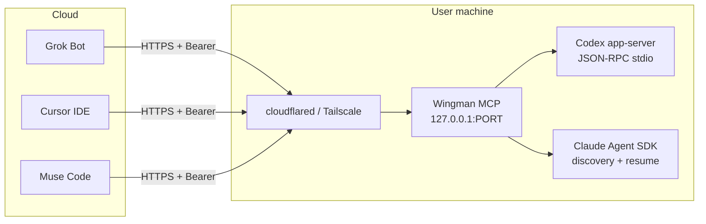

# Wingman

**Your coding agent's wingman.** A TypeScript MCP bridge and pair CLI so Grok Bot, Cursor, Muse Code, and other MCP hosts can talk to live Codex and Claude Code sessions on your machine while you still see the session.

Dual-provider: Codex (app-server) + Claude Code (Agent SDK).

[](https://github.com/juangurdian/wingman/actions/workflows/ci.yml)
[](LICENSE)
[](tsconfig.json)
[](https://nodejs.org/)

See **[ROADMAP.md](ROADMAP.md)** for positioning, backlog, and non-goals.

---

## Why Wingman?

Cloud assistants are great copilots until they need to *touch* the session you're already in. Wingman sits on your machine, pairs with a one-command CLI, and exposes a small MCP surface so a remote host can list threads, read transcripts, send messages, and interrupt turns, without hijacking your TTY or pretending to be the agent UI.

Think of it as a radio link between the bot in the cloud and the agent on your desk. You're still flying; Wingman just rides shotgun.

## Quickstart

### Clone and run (recommended)

```bash
git clone https://github.com/juangurdian/wingman.git
cd wingman
npm install
npm run pair
```

Set `CODEX_MOCK=1` or `CLAUDE_MOCK=1` for mock mode (no real agent required).

> **npm status:** the `wingman-mcp` package is not published to npm yet, so `npx wingman-mcp` and
> `npm install -g wingman-mcp` will not work today. Use the clone-and-run steps above. This section
> will switch back to `npx` once the package is published.

### After pairing

1. **Pair.** `wingman-pair` generates a bearer token, writes `~/.wingman/config.json`, and starts MCP on `127.0.0.1:3847/mcp`. The token is printed as a short prefix (`abcd…`). Pass `--show-token` once, while you paste it into the connector.
2. **Tunnel.** Remote hosts cannot reach localhost. The stable public URL is Tailscale Funnel:

   ```bash
   wingman-tunnel tailscale
   # Windows, when tailscale is not on PATH:
   wingman-tunnel tailscale --bin "C:\Program Files\Tailscale\tailscale.exe"
   ```

   That runs `tailscale funnel --bg 3847`, reads `Self.DNSName` from `tailscale status --json`, and prints `https://<name>/mcp`. `--bg` is stored by tailscaled, so the URL stays put across reboots as long as Tailscale starts. Other options, ranked for durability:

   ```bash
   # Tailscale Serve (stable, only your tailnet)
   tailscale serve --bg 3847

   # Cloudflare named tunnel (stable, custom domain)
   # Run 'wingman-tunnel' for one-time setup instructions
   cloudflared tunnel run wingman

   # Cloudflare quick tunnel (ephemeral, for demos). The hostname changes every start.
   cloudflared tunnel --url http://127.0.0.1:3847
   ```

   `wingman-tunnel diagnose` probes local `/healthz`, the heartbeat, and Funnel. If Funnel is not approved, the report includes `Funnel not enabled on tailnet` and the approval link Tailscale prints.

3. **Add MCP server** (Grok Bot / Cursor `AddMcpServer`):

   | Field | Value |
   |-------|--------|
   | **name** | `wingman` |
   | **url** | `https://<magic-dns-name>/mcp` |
   | **Authorization** | `Bearer <token from ~/.wingman/config.json>` |

Then ask the host to call `list_sessions` → `read_transcript` / `send_message` / `interrupt`.

### Host-specific guides

Different MCP hosts have different configuration methods. See the detailed guides:

| Host | Support | Guide |
|------|---------|-------|
| **Grok Bot** | ✅ Full | [docs/hosts/remote-hosts.md](docs/hosts/remote-hosts.md) |
| **Cursor IDE** | ✅ Full | [docs/hosts/cursor-ide.md](docs/hosts/cursor-ide.md) |
| **Muse Code** | ✅ Full | [docs/hosts/muse-code.md](docs/hosts/muse-code.md) |
| **Claude Desktop** | ⚠️ Limited | [docs/hosts/claude-desktop.md](docs/hosts/claude-desktop.md) |
| **Other clients** | Varies | [docs/hosts/generic-mcp-client.md](docs/hosts/generic-mcp-client.md) |

> **Note**: Wingman is a remote HTTP MCP server. Hosts that support HTTP + bearer auth work natively. Stdio-only hosts (like Claude Desktop) require a bridge. See the Claude Desktop guide for workarounds.

### Real provider modes

**Codex.** Requires `codex` on `PATH`. Wingman speaks **Codex app-server** JSON-RPC (`codex app-server` over stdio).

```bash
npm run pair   # unset CODEX_MOCK
```

**Claude Code.** Uses the `@anthropic-ai/claude-agent-sdk`. Sessions are created and resumed through the SDK.

```bash
npm run pair   # unset CLAUDE_MOCK
```

Docs: [Codex App Server](https://learn.chatgpt.com/docs/app-server) · [Claude Agent SDK](https://code.claude.com/docs/en/agent-sdk/typescript)

## Can / Can't

**Can**

- Pair in **mock mode** with no agent install (`CODEX_MOCK=1` or `CLAUDE_MOCK=1`)
- Bridge Grok Bot ↔ local Codex threads via app-server once tunneled
- Bridge Grok Bot ↔ local Claude Code sessions via Agent SDK once tunneled
- **Discover existing Claude sessions** via SDK's `listSessions()` (sessions you created via `claude` CLI or Claude Code IDE)
- Resume discovered sessions by ID. The SDK reads session state from `~/.claude/projects/`
- Send messages to sessions asynchronously (returns `accepted` quickly; turn runs in background)
- Check session status (idle vs running) via `get_session` or `list_sessions`
- Bearer-protect the MCP HTTP endpoint
- Create / list / read / message / interrupt sessions (real or mock) for both providers
- Keep you in the loop. The session stays visible on your machine

**Can't (scope / v1 limits)**

- Reach the bridge from a remote host without a **tunnel** (binds loopback only)
- **Type into an open TTY.** SDK resume is not the same as injecting keystrokes into a Claude or Codex terminal you're watching. Wingman calls SDK APIs that operate on session state files, not terminal processes.
- Hijack arbitrary Claude or Codex TTYs you already have open elsewhere. Wingman manages sessions via SDK, not by attaching to interactive shells.
- Interrupt a discovered session reliably unless Wingman started the current turn (no active query handle)
- Auto-approve sandbox prompts (approvals still belong to the local agent client)
- Use legacy `codex mcp-server` (removed / not used here)

## Staying up, and keeping the token quiet

The listen address defaults to `127.0.0.1`. DNS rebinding protection stays on. The Host allowlist is loopback, plus any of these:

- `WINGMAN_TUNNEL_HOST`
- `WINGMAN_ALLOWED_HOSTS` (comma-separated hostnames)
- `tunnelHost` in `~/.wingman/config.json` (set by `wingman-tunnel tailscale`)
- the hostname stored in `~/.wingman/tunnel-state.json`

To listen on every interface, run `wingman-pair --host 0.0.0.0` or set `WINGMAN_HOST=0.0.0.0`. Protection stays on. Requests whose Host header is not on the allowlist are rejected. The running server re-reads that list on each request, so a Funnel or quick-tunnel hostname saved after startup is accepted without a restart.

Rotate a token without starting the server:

```bash
wingman-pair --rotate-token
wingman-token rotate          # same thing
wingman-token rotate --show-token
```

The new token is written to `~/.wingman/config.json`. A process that is already running keeps the old token until it restarts. `WINGMAN_TOKEN` in the environment wins over the file. Pair, doctor, diagnose, and error text show a short prefix unless you pass `--show-token`. A token that starts with `smoke-`, `test-`, or another obvious fixture is a warning. Rotate it before the bridge is reachable.

On Windows, install a logon task that reuses the token and can bring the tunnel back:

```bash
wingman-task install --tunnel tailscale --tailscale-bin "C:\Program Files\Tailscale\tailscale.exe"
wingman-task install --tunnel quick
```

Funnel `--bg` persists in tailscaled, so the task checks that it is active and runs `tailscale funnel --bg` only when this port is not published. The quick tunnel option starts cloudflared, waits for the `trycloudflare.com` URL, and records that hostname. The hostname still changes every start. A failed launch is reported and does not count as a running tunnel.

`~/.wingman/heartbeat.json` is rewritten about every 15 seconds while this process is running. `get_bridge_status` and `wingman-doctor` set a warning when the file is missing or older than 5 minutes. A stale beat means Wingman is stopped, hung, or the machine slept and nothing wrote a new beat. It does not by itself mean the tunnel is down. After a reboot, a stale or missing file means the scheduled task did not bring the process back.

Child processes are spawned with `shell: false`. On Windows, a `.exe` is spawned directly. A `.cmd` or `.bat` shim is run through `cmd.exe /d /s /c` with a quoted command line, so Node does not emit DEP0190.

Details: [Operations](docs/operations.md) and [Security](SECURITY.md).

## Architecture



## MCP tools

| Tool | Args | Notes |
|------|------|--------|
| `list_sessions` | `provider?`: `codex` \| `claude`, `state?`: `live` \| `past` \| `all` | Lists sessions. `state` is Claude inbox liveness (a running registry pid). Live sessions sort first. Each row includes `pendingApprovalAgeMs` and `stalled_on_approval` (default threshold 10 minutes, `WINGMAN_APPROVAL_STALL_MS`). |
| `get_session` | `provider`, `session_id` | Get detailed session info including status (`idle` / `running`), tags, and host identity |
| `read_transcript` | `provider`, `session_id`, `limit?` | Recent messages (newest at end) |
| `send_message` | `provider`, `session_id`, `text`, `model?`, `max_turns?`, `permission_mode?`, `allowed_tools?`, `disallowed_tools?`, `fork_session?`, `approval_timeout_ms?`, `force?`, `inbox_fallback?`, `inbox_pickup_ms?` | Codex: `turn/start` (warns if another client has the thread loaded unless `force`). Claude live sessions are written to the inbox. If the session stays idle, status is `queued_not_started`. `inbox_fallback: "headless"` resumes headless only after that wait, and only while the session is idle. A second send during an active Wingman turn is rejected. |
| `interrupt` | `provider`, `session_id` | Codex: `turn/interrupt`. Claude: aborts the Wingman-owned headless query (`AbortController` and `Query.interrupt()`). |
| `create_session` | `provider`, `cwd?`, `prompt?`, `name?`, `tags?`, `model?`, `max_turns?`, `permission_mode?`, `allowed_tools?`, `disallowed_tools?`, `approval_timeout_ms?` | Codex: `thread/start` with optional model override. Claude: new headless session. Model is optional for both. |
| `wait_turn` | `provider`, `session_id`, `timeout_ms?`, `poll_interval_ms?` | Wait for a Codex or Claude turn to complete, fail, or time out. Returns early while a permission prompt is waiting. |
| `steer` | `provider`, `session_id`, `text` | Add guidance to an in-flight turn. Codex: `turn/steer`. Claude: queues a user message on the active headless query. |
| `list_approvals` | `provider`, `session_id` | List pending Codex or Claude approval requests. |
| `resolve_approval` | `provider`, `session_id`, `approval_id`, `decision` | Accept, accept for the session, decline, or cancel a Codex or Claude approval. |
| `set_session_meta` | `provider`, `session_id`, `name?`, `tags?` | Set session name/tags for easier discovery (Wingman-owned sessions) |
| `export_transcript` | `provider`, `session_id`, `format`, `limit?` | Export transcript as `markdown` \| `json`; returns content + writes to `~/.wingman/exports/` |
| `get_bridge_status` | (none) | This process is up: pid, uptime, and how to read a later failure. `heartbeatStale` is true when `heartbeat.json` is missing or older than 5 minutes. See [Operations](docs/operations.md). |
| `list_claude_live_sessions` | (none) | Interactive Claude sessions from the inbox registry and `claude agents`. `live` is true only while the pid is running. |
| `send_to_claude_session` | `target`, `text` | Send text to a live interactive session by id, name, or pid. Past sessions are refused. |
| `get_status` | `provider`, `session_id`, `caller?` | `idle`, `working`, `awaiting_approval`, or `errored`, plus last activity, pending prompt, model, git HEAD, dirty files, RSS, `pendingApprovalAgeMs`, and `stalled_on_approval` |
| `start_codex_exec` | `prompt`, `cwd`, `sandbox?`, `model?`, `resume_session_id?` | Headless `codex exec` (CLI 0.166). No `--full-auto`. Prompt goes to stdin. Returns a run id. |
| `run_headless` | `prompt`, `cwd?`, `session_id?`, `max_turns?`, `permission_mode?`, `model?` | Long Claude run. Prompt is an SDK string, not a PowerShell command. Returns a run id. |
| `get_run` | `run_id`, `tail_lines?` | Poll a headless run: status, exit code, output tail, RSS |
| `stop` | `session_id?`, `run_id?`, `provider?`, `force?` | Interrupt a session or kill a headless run. Reports memory use. |

### create_session behavior

For **Claude sessions**, `create_session` returns immediately:
- **Without prompt**: Returns `{ sessionId, status: "created", resumeMode: "new", maxTurns, permissionMode }`. The session is registered and no turn is running.
- **With prompt**: Returns `{ sessionId, status: "accepted", turnId, ... }` and the initial prompt runs in the background, so the MCP HTTP call does not wait for the model.

Optional Claude fields: `model`, `max_turns` (default 50), `permission_mode` (default `default`), `allowed_tools`, `disallowed_tools`, `approval_timeout_ms` (default 120000). Omit `model` and Claude Code chooses its own default. Do not pass an old model id unless you mean that exact id.

For **Codex sessions**, `create_session` calls `thread/start` and returns `{ sessionId, status: "created" | "accepted", model? }`.

### Codex model override

By default, Wingman does **not** override the Codex model. It uses whatever is configured in `~/.codex/config.toml` or Codex's built-in defaults. Override only when you intentionally need a different model for Wingman-created sessions:

**Via environment variable**:
```bash
export WINGMAN_CODEX_MODEL="your-preferred-model"
npm run pair
```

**Via create_session argument** (per-session):
```json
{ "provider": "codex", "model": "your-preferred-model", "prompt": "Hello" }
```

**Priority order**: `create_session.model` > `WINGMAN_CODEX_MODEL` env > user's `~/.codex/config.toml` > Codex defaults

**Note**: Some models may require API access rather than a ChatGPT subscription. If session creation fails due to model access, either ensure you have the required access level, or let Codex pick its default by not setting a model override. Run `wingman-doctor` to check for models that may require API access.

### send_message behavior

For a **live interactive Claude session** (registry file plus a running pid), `send_message` writes the text to that session's inbox socket or Windows named pipe. The wire format is an auth line plus a user message. It has no extra submit line.

What comes back depends on what the interactive session does during `inbox_pickup_ms` (default 5000, or `WINGMAN_INBOX_PICKUP_MS`):

| What Wingman sees | `status` | Headless resume |
|---|---|---|
| Session was idle and then left idle (busy, running, or working) | `delivered_via_inbox`, `inboxState: "started"` | No |
| Session was already mid-turn | `delivered_via_inbox`, `inboxState: "queued_mid_turn"` | No. The text is for delivery between tool calls. |
| Session stayed idle | `queued_not_started` | Only if `inbox_fallback` is `"headless"` (or `WINGMAN_INBOX_FALLBACK=headless`). The composer may still hold the text, so pressing Enter there can run it a second time. |
| Session phase was not visible | `queued_not_started` | No. Wingman will not guess that the session is idle. |
| Write failed while the session is mid-turn or the phase is unknown | `inbox_not_delivered` | No |

Some Claude Code builds, including Windows desktop builds in the 2.1.227 line, accept the socket write and only place the text in the composer until a person presses Enter. That is why a successful write is not reported as a started turn unless the session actually leaves idle. `send_to_claude_session` uses the same watch and the same `inboxState` values. It does not start a headless resume.

If the inbox write fails and the session is idle, Wingman falls back to the headless path below. A headless Agent SDK query does not appear in the open terminal.

For **other Claude sessions**, `send_message` returns immediately with `{ status: "accepted", turnId, resumeMode, maxTurns, permissionMode, model?, modelSource, attachedToTerminal: false, note }` while the SDK query runs in the background. Use `wait_turn`, `get_session`, or `read_transcript` to observe progress. This keeps the MCP HTTP call from waiting on the model.

If a Wingman turn is already active, `send_message` throws `turn already active; use steer or interrupt` and does not replace that turn. Approval timeout values, including `WINGMAN_CLAUDE_APPROVAL_TIMEOUT_MS`, are capped at 600000 ms so a huge timer cannot collapse to 1 ms.

Per-call fields override the `WINGMAN_CLAUDE_*` defaults below. `max_turns` defaults to 50 (not 1). `permission_mode` defaults to `default`, and Wingman sets `permissionPrompts: "host"` so tool prompts reach `list_approvals` instead of being auto-denied.

Model priority for a Claude turn:

1. `send_message.model` or `create_session.model`
2. `WINGMAN_CLAUDE_MODEL`
3. The model already stored for that session (resume)
4. Omit the flag and let Claude Code use its own default

Wingman never substitutes a built-in model id. Passing the session model on resume is what stops a headless query from falling through to the CLI default.

For **Codex sessions**, `send_message` blocks until `turn/start` returns (typically fast), then returns `{ status: "completed" | "inProgress" }`. Claude-only fields are ignored.

### Resume, fork, and open terminals

`send_message` on Claude resumes that session id with `forkSession: false` unless you pass `fork_session: true`.

| `resumeMode` | Meaning |
|--------------|---------|
| `resume` | Same session id. The headless query continues the session file. |
| `fork` | A new session id is copied from the original. The original is left unchanged. `actualSessionId` is the copy (immediately in mock mode, and on `wait_turn` / `get_session` once the CLI reports it in real mode). |
| `new` | `create_session` started a new id. |

`attachedToTerminal` is `true` only for inbox delivery. A headless Agent SDK query does not attach to an already-open interactive Claude Code terminal, so that turn will not appear there. That limit is in the CLI: Wingman can read and resume the session file, and it cannot type into a TUI that already holds the session unless the inbox socket is bound. `--bare` sessions do not bind an inbox. If that terminal has the transcript open, the CLI may still fork a new id even when `fork_session` is false. Check `actualSessionId` on `get_session` and `wait_turn`. To watch relayed turns, read them with `read_transcript`, or reopen the session id in Claude Code after the turn finishes.

`list_claude_live_sessions` and `send_to_claude_session` talk to that inbox directly. `get_status` still reports `idle`, `working`, `awaiting_approval`, or `errored`, and also includes `live`, `processPid`, and `liveStatus` when the session record has them. See [Live session injection](docs/live-session-injection.md).

Codex can attach to a shared app-server socket (`WINGMAN_CODEX_SOCKET=auto` or a path) instead of spawning its own process. The WebSocket client disables permessage-deflate. If the socket is missing, Wingman spawns a private app-server and logs the reason. `wingman-live-setup` prints the daemon and TUI steps. See [Codex shared server](docs/codex-shared-server.md).

### interrupt behavior

For **Claude sessions**, `interrupt` works when Wingman owns the active turn (you called `send_message` or `create_session` through Wingman for the current turn). It aborts the query, calls `Query.interrupt()` on the streaming headless process, and denies any permission prompt that is still open. Returns `{ status: "interrupted", turnId }` on success, or `{ status: "no_active_turn" }` if the session is idle.

**Limitation**: Interrupting a turn that was started outside Wingman (for example in the Claude CLI directly) does not work. Wingman has no query handle to abort. Use `Ctrl+C` in that terminal.

For **Codex sessions**, `interrupt` requires a known active `turnId` tracked from `turn/started` notifications.

### Session tags/names

Sessions can have human-friendly names and tags for easier discovery and filtering:

**create_session**: Pass `name` and/or `tags` when creating a session:
```
create_session({ provider: "claude", cwd: "/project", name: "Auth Refactor", tags: ["refactor", "auth"] })
```

**set_session_meta**: Update name/tags on existing Wingman-owned sessions:
```
set_session_meta({ provider: "claude", session_id: "sess_123", name: "Updated Name", tags: ["new", "tags"] })
```

Sessions returned by `list_sessions` and `get_session` include `name` and `tags` fields. For discovered Claude sessions, the legacy `tag` field is also converted to `tags`.

**Note**: In real mode, `set_session_meta` only works for Wingman-owned sessions (sessions created via Wingman's `create_session`). Codex real mode does not support custom metadata.

### wait_turn (Codex and Claude)

**wait_turn** provides long-poll waiting instead of busy-polling `read_transcript`. It works for both Codex and Claude sessions.

For **Claude sessions**, `wait_turn` polls until the turn completes, times out, or the session is idle. Real Claude cold starts can take 1-3+ minutes. Use `wait_turn` so the MCP client does not hit its HTTP timeout. If a tool prompt is waiting, `wait_turn` returns immediately with `status: "inProgress"` and a message that approvals are pending. Resolve them, then call `wait_turn` again.

Example Claude workflow:
```
1. create_session(prompt: "Build a web scraper")  →  { status: "accepted", turnId: "turn_1" }
2. wait_turn(timeout_ms: 180000)                  →  { status: "completed", latestMessage: "I've created..." }
```

For **Codex sessions**, `wait_turn` returns when the turn completes, fails, is interrupted, times out, or when approvals are pending.

Example response:
```json
{ "sessionId": "thr_123", "turnId": "turn_456", "status": "completed", "latestMessage": "Done!" }
```

### steer

**steer** adds guidance to an in-flight turn without starting a new one.

- **Codex**: Uses `turn/steer`.
- **Claude**: Queues a user message on the active headless query (`priority: "now"`) so the CLI can fold it into the running turn. This only reaches a query Wingman started. It does not steer an interactive terminal. If no Wingman turn is active, the tool returns an error telling you to `send_message`, or to `interrupt` and then `send_message`.

### list_approvals and resolve_approval

Both tools work for Codex and Claude.

- **Codex**: JSON-RPC approval requests for sandbox commands, file changes, or network access.
- **Claude**: The Agent SDK `canUseTool` callback parks each prompt until the supervisor resolves it. `list_approvals` returns the tool name, kind (`command`, `fileChange`, or `network`), and a short summary. Decisions:
  - `accept`: allow this call once
  - `acceptForSession`: allow this call and the same tool action for the rest of the Wingman session
  - `decline`: deny the tool
  - `cancel`: deny the tool and interrupt the turn

If nobody resolves a Claude prompt before `approval_timeout_ms` (default 120000, or `WINGMAN_CLAUDE_APPROVAL_TIMEOUT_MS`), Wingman denies it. `permission_mode: "dontAsk"` still denies without a prompt, because that mode has no approval surface. `bypassPermissions` skips prompts and requires the SDK's explicit bypass flag, which Wingman sets only when you choose that mode.

Example approval flow:
```
1. send_message("update the lockfile")   →  { status: "accepted" }
2. wait_turn()                            →  { status: "inProgress", latestMessage: "Waiting for 1 approval(s)" }
3. list_approvals()                       →  { approvals: [{ id: "appr_1", kind: "command", toolName: "Bash", command: "git status" }] }
4. resolve_approval("appr_1", "accept")   →  { resolved: true }
5. wait_turn()                            →  { status: "completed" }
```

**Note**: In Codex mock mode (`CODEX_MOCK=1`), commands containing `sudo` or `rm -rf` trigger simulated approval requests. In Claude mock mode (`CLAUDE_MOCK=1`), a message shaped as `[approval-request ToolName] args` parks the turn on a prompt so you can test `list_approvals` without a real CLI.

## Environment variables

### General

| Variable | Default | Description |
|----------|---------|-------------|
| `WINGMAN_TOKEN` | (generated) | Bearer token for MCP auth |
| `WINGMAN_PORT` | `3847` | MCP server port |
| `WINGMAN_HOST` | `127.0.0.1` | MCP server bind address |
| `WINGMAN_WAIT_TURN_TIMEOUT_MS` | `60000` | Default timeout for `wait_turn` polling |
| `WINGMAN_WAIT_TURN_POLL_MS` | `500` | Default poll interval for `wait_turn` |
| `WINGMAN_HEALTHZ_AUTH_FREE` | `false` | Set to `1` to allow unauthenticated `/healthz` access |

### Codex

| Variable | Default | Description |
|----------|---------|-------------|
| `CODEX_MOCK` | unset | Set to `1` for in-memory mock mode |
| `CODEX_BIN` | `codex` | Path to Codex CLI binary |
| `CODEX_APP_SERVER_ARGS` | `app-server` | Args passed to Codex binary |
| `CODEX_RPC_TIMEOUT_MS` | `60000` | JSON-RPC timeout |
| `WINGMAN_CODEX_MODEL` | unset | Override Codex model for Wingman sessions (optional; defaults to Codex config/defaults) |

### Claude

| Variable | Default | Description |
|----------|---------|-------------|
| `CLAUDE_MOCK` | unset | Set to `1` for in-memory mock mode |
| `CLAUDE_DISCOVER` | `1` | Set to `0` to disable session discovery |
| `CLAUDE_DISCOVER_DIRS` | (all) | Directories to search, separated by the OS path delimiter (`:` on macOS and Linux, `;` on Windows) so drive letters stay intact |
| `CLAUDE_SEND_TIMEOUT_MS` | `120000` | Timeout for Claude SDK send operations |
| `WINGMAN_CLAUDE_MAX_TURNS` | `50` | Agent turns allowed in one Claude query (cap 500). Per-call `max_turns` wins. |
| `WINGMAN_CLAUDE_PERMISSION_MODE` | `default` | `default`, `acceptEdits`, `bypassPermissions`, `plan`, `dontAsk`, or `auto` |
| `WINGMAN_CLAUDE_ALLOWED_TOOLS` | unset | Comma-separated Claude tools that skip the permission prompt |
| `WINGMAN_CLAUDE_DISALLOWED_TOOLS` | unset | Comma-separated Claude tools removed from the session |
| `WINGMAN_CLAUDE_MODEL` | unset | Optional model override. Unset inherits the session model, then Claude Code's own default. Never set this to pin an old model by accident. |
| `WINGMAN_CLAUDE_APPROVAL_TIMEOUT_MS` | `120000` | Deny a Claude permission prompt that is not resolved in time |

The Claude provider uses the bundled Agent SDK binary automatically. No separate `claude` CLI install is required unless you override `pathToClaudeCodeExecutable` in code.

### Multi-Host

| Variable | Default | Description |
|----------|---------|-------------|
| `WINGMAN_HOST_ID` | hostname | Machine identifier for multi-host setups |
| `WINGMAN_HOST_NAME` | hostname | Human-friendly host name for display |
| `WINGMAN_CALLER` | `default` | Caller id used when a tool omits `caller` |
| `WINGMAN_ALLOWED_PATHS` | unset | Project roots this process may touch, split on the OS path delimiter (`:` or `;`) |

See [docs/hosts/multi-host.md](docs/hosts/multi-host.md) for running Wingman on multiple machines.

## Session management

### Wingman-managed sessions

Wingman tracks sessions it creates in a local registry (`~/.wingman/claude-sessions.json` for Claude). This ensures:

1. **Isolation.** Only sessions started through Wingman's `create_session` are visible to MCP clients by default
2. **No TTY hijack.** We don't scan for or attach to Claude/Codex processes you started elsewhere
3. **Resumable.** Sessions can be resumed by ID across Wingman restarts

### Claude session discovery

Wingman can also **discover existing Claude Code sessions** via the Agent SDK's `listSessions()`. This allows `list_sessions` to find sessions the user created via `claude` CLI or Claude Code IDE, not only sessions created through Wingman.

**How discovery works:**
1. `list_sessions` merges Wingman's registry with sessions discovered via SDK
2. If the same session ID exists in both, the Wingman registry entry takes precedence
3. `read_transcript`, `send_message`, and `interrupt` work for discovered sessions by resuming via `query({ options: { resume: sessionId, forkSession: false } })`
4. When you interact with a discovered session, it's auto-registered in Wingman's registry

**What discovery is NOT:** This is not TTY hijacking. Wingman does not attach to terminal processes, scrape windows, or take over interactive sessions. Discovery reads session files on disk via official SDK APIs. A headless resume is not visible in an already-open interactive terminal. See [Resume, fork, and open terminals](#resume-fork-and-open-terminals).

Set `CLAUDE_DISCOVER=0` to disable discovery and only show Wingman-created sessions.

### SessionSummary fields

Sessions returned by `list_sessions` include:

| Field | Type | Description |
|-------|------|-------------|
| `source` | `'wingman' \| 'discovered'` | Origin of the session |
| `name` | `string?` | Human-friendly session name |
| `tags` | `string[]?` | User-set tags for categorization/filtering |
| `gitBranch` | `string?` | Git branch at end of session (discovered) |
| `tag` | `string?` | Legacy single tag (discovered sessions only) |

### Claude session storage

Claude sessions are stored by the Agent SDK in `~/.claude/projects/<project-key>/<session-id>.jsonl`. Wingman's registry maps session IDs to their working directories so `listSessions()` and `readTranscript()` can locate them.

## Scripts & CLI

From a checkout, run these through `npm run` (the bare commands below are what a global npm install will provide once the package is published):

| Command | Purpose |
|---------|---------|
| `wingman-pair` / `wingman-mcp` | Generate token, save config, start MCP, print pair instructions |
| `wingman-doctor` | Check environment: Node version, config, port, Claude SDK / Codex binary |
| `wingman-tunnel` | Detect tunnel tools, print ranked setup commands, persist tunnel state. `diagnose` and `classify` tell tunnel failures apart. |
| `wingman-task` | Install a Windows scheduled task that restarts on crash and reuses the bearer token |

For local development:

| Script | Purpose |
|--------|---------|
| `npm run pair` | Same as `wingman-pair` (uses tsx) |
| `npm run doctor` | Same as `wingman-doctor` |
| `npm run tunnel` | Same as `wingman-tunnel` |
| `npm run task` | Same as `wingman-task` |
| `npm run dev` | Start MCP only (needs existing config/token) |
| `npm run build` | Compile TypeScript → `dist/` |
| `npm test` | Vitest unit tests (mocked providers) |

## Config

`~/.wingman/config.json` (new installs). If you still have a legacy `~/.session-bridge/config.json`, Wingman will read it as a fallback.

```json
{
  "token": "...",
  "host": "127.0.0.1",
  "port": 3847,
  "mcpPath": "/mcp",
  "createdAt": "...",
  "mock": true
}
```

## Health Endpoint

Wingman exposes a `/healthz` endpoint for monitoring and tunnel health checks.

**Default behavior**: Requires bearer authentication (same token as `/mcp`).

**Auth-free mode**: Set `WINGMAN_HEALTHZ_AUTH_FREE=1` to allow unauthenticated access to `/healthz`. This is useful for:
- Cloudflare Tunnel health checks
- Load balancer probes
- Uptime monitors that can't send auth headers

```bash
# Enable auth-free healthz (document the security tradeoff)
WINGMAN_HEALTHZ_AUTH_FREE=1 npm run pair
```

**Security tradeoff**: An auth-free `/healthz` reveals that Wingman is running but exposes no secrets, session data, or MCP functionality. The `/mcp` endpoint always requires bearer auth.

Example response while the process is alive:
```json
{ "ok": true, "service": "wingman", "state": "server_up", "pid": 123, "uptimeMs": 1000 }
```

`/status` returns the same body. If the call fails, the client has to classify the error itself. `get_bridge_status` repeats the rules, and `wingman-tunnel diagnose` can see them from the machine. Full table: [docs/operations.md](docs/operations.md).

| What the client sees | State |
|---|---|
| HTTP 200 from `/healthz` | `server_up` |
| HTTP 401 or 403 | `auth_rejected` (Wingman is up) |
| Cloudflare 1033 or HTTP 530 | `tunnel_down` |
| HTTP 502 or 504 | `server_down` (tunnel up, Wingman down) |
| `fetch failed`, DNS error, or timeout with no HTTP status | `host_offline` |

## Doctor / Health Check

Run `npm run doctor` (or `wingman-pair --doctor`) to verify your environment:

```bash
npm run doctor
```

Checks:
- Node.js version (20+ required)
- Config file (`~/.wingman/config.json`)
- Port availability (3847 by default)
- Claude Agent SDK availability (unless `CLAUDE_MOCK=1`)
- Codex binary on PATH (unless `CODEX_MOCK=1`)

The doctor prints clear next steps if any check fails.

## Agent skill

See [`skills/pair-coding-sessions/SKILL.md`](skills/pair-coding-sessions/SKILL.md) for setup / pair / operate steps aligned with this CLI.

## Security

See [SECURITY.md](SECURITY.md) for security policy, bearer token handling, and best practices.

## Community

Open-source. MVP: Codex and Claude providers work (mock and real). APIs may shift before 1.0.

Issues and PRs welcome. See [CONTRIBUTING.md](CONTRIBUTING.md). Ideas for tunnel helpers, provider improvements, and other MCP-host guides are especially useful.

If Wingman helped you pair a session, star the repo or open an issue with what you tried. Good wingmen share the checklist.

## Develop

```bash
git clone https://github.com/juangurdian/wingman.git
cd wingman
npm install
npm run doctor              # check environment
npm test                    # run tests
npm run build               # compile TypeScript
CODEX_MOCK=1 npm run pair   # or CLAUDE_MOCK=1
```

Node 20+. Success criteria: install, test, build succeed; mock pair prints URL + token.

## License

[MIT](LICENSE) © Juan Gurdian and contributors
